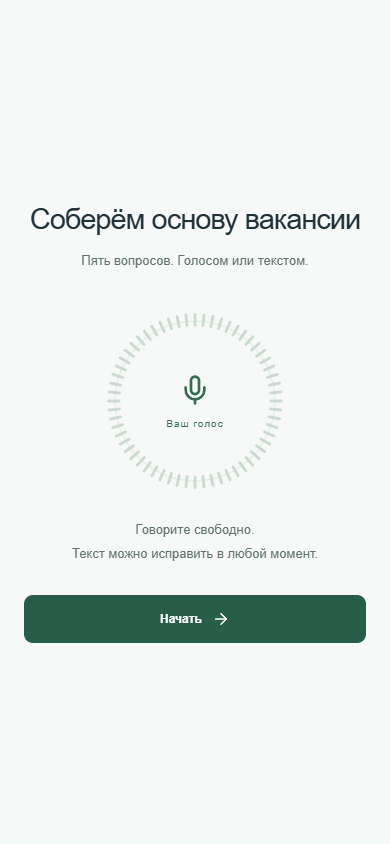

# Основа вакансии

[Запуск и подключение AI](DEPLOYMENT.md) · [Спецификация](SPEC.md) · [Соответствие ТЗ](DELIVERY.md) · [Секреты и данные](SECURITY.md)



Компактный голосовой конструктор для бизнес-заказчика. Пять ответов превращаются в профессионально написанную основу вакансии: описание роли, задачи, планы и навыки. Условия, которых заказчик не назвал, остаются уточнениями.

## Запуск

Нужны Node.js 22.19+ и npm:

```sh
npm ci
npm run dev
```

Открыть http://127.0.0.1:4173. Один сервер обслуживает интерфейс и API. Для облачного AI скопировать `.env.example` в `.env`, указать `GROQ_API_KEY`, перезапустить сервер. Ключ хранится только на сервере и не публикуется. Рабочая модель задаётся `GROQ_MODEL`, по умолчанию `qwen/qwen3.8-27b`.

## Пользовательский сценарий

1. Нажать «Начать» или «Продолжить черновик».
2. Назвать позицию, затем описать ежедневные задачи, проект, планы на полгода и навыки. Отвечать голосом или текстом. Перед переходом остановить микрофон и проверить распознанные слова.
3. Просмотреть все ответы, исправить любой из них. При необходимости нажать «Проверить полноту».
4. Нажать «Собрать основу». AI исправит речь, уберёт повторы и свяжет мысли без добавления новых фактов.
5. Отредактировать результат, скопировать или скачать Markdown.

На телефоне и компьютере используется одна колонка. Нет шапки, рекламных блоков, загрузки файлов или обязательной регистрации. Круг показывает заполненность пяти ответов. Ответы и результат сохраняются в браузере. При обновлении готовый результат восстанавливается; незавершённый черновик можно продолжить. При миграции старых четырёх ответов добавляется пустой вопрос о позиции, прежние тексты и результат сохраняются.

Микрофон включается только по нажатию. SpeechRecognition зависит от браузера, разрешения, сети и localhost/HTTPS; при недоступности остаётся текстовый ввод. Распознавание браузера может использовать внешний сервис. AI-запросы отправляются Groq. Не включайте конфиденциальные данные в публичную демонстрацию.

## Резервные режимы

Без ключа, при лимите Groq или сбое генерации приложение собирает явно подписанный шаблон из ответов. Он не выдаётся за AI-редактуру. При недоступности AI-проверки полноты показаны базовые подсказки по правилам. Подсказки не блокируют продолжение; каждый ответ должен содержать от 3 до 6000 символов.

## Проверки

```sh
npm test
npm run lint
npm run build
npm run test:browser
```

10 Node-тестов проверяют данные, шаблон, резервные режимы и контракты провайдеров с подменой upstream. 7 браузерных тестов проверяют основной путь, мобильную ширину, API-ошибки, распознаватель с подставным API, отмену и миграцию черновика. Используется установленный Chrome; другой поддерживаемый канал задаётся `PLAYWRIGHT_CHANNEL`.

Реальный облачный UI-прогон: `node scripts/cloud-browser.mjs`. Он заполняет пять ответов, вызывает настоящий AI-анализ и генерацию, редактирует текст, скачивает файл и проверяет reload. Требует ключа и расходует квоту. Последний прогон новой версии прошёл успешно. Физический микрофон в этом прогоне не используется.

`node scripts/cloud-smoke.mjs artifacts/speech-test.wav` дополнительно проверяет серверный STT на синтезированной русской речи. Этот API остался техническим сервисом; загрузки файлов в пользовательском интерфейсе нет.

## Материалы для сдачи

- `DELIVERY.md`: соответствие исходному ТЗ, решения, сделанное и оставшееся, порядок работ и использование AI.
- `FEATURE.md`: описание функции для пользователя и демонстрационный сценарий.
- `SPEC.md`: состояния, данные, ошибки, API и ограничения.
- `AGENTS.md`: инструкции для агентной разработки.
- `artifacts/demo-ai.webm`: актуальный сценарий пяти вопросов с реальным AI, без имитации физической диктовки.
- `artifacts/presentation.pptx`: пользовательская презентация.
- `artifacts/desktop.png`, `artifacts/mobile.png`, `artifacts/ai-result.png`: актуальные экраны.

## Архитектура и размещение

`src/App.tsx` управляет сценарием, `src/hooks/useVoiceInput.ts` владеет распознавателем, `shared/domain.mjs` содержит вопросы, правила и шаблон, `shared/service.mjs` вызывает Groq. `server.mjs` обслуживает локальный HTTP и Vite. `api/*.ts` адаптируют сервис для Vercel.

`npm run build` создаёт `dist`. `npm run preview` обслуживает только статику, поэтому для полного локального сценария нужен `npm run dev`. Для Vercel подготовлены Vite build, output `dist` и serverless-функции; публичное размещение не проверялось. Перед общедоступным AI-деплоем нужны ограничения запросов и бюджета. Публичный репозиторий: https://github.com/AndreyPalyS/voice-vacancy. Настройка собственного ключа и варианты хостинга подробно описаны в DEPLOYMENT.md.

Ранние `../ANALYSIS_AND_PLAN.md` и `../gpt_chat_transcript.md` не описывают актуальный интерфейс. Текущая спецификация находится в этом каталоге.

## Сборка Sites

`npm run build:sites` создаёт Worker с UI и API. Секрет задаётся в production runtime Site и не входит в исходники. Подробные шаги, CI и отличия от GitHub Pages — в DEPLOYMENT.md.
